## Diagrama ER (geral)

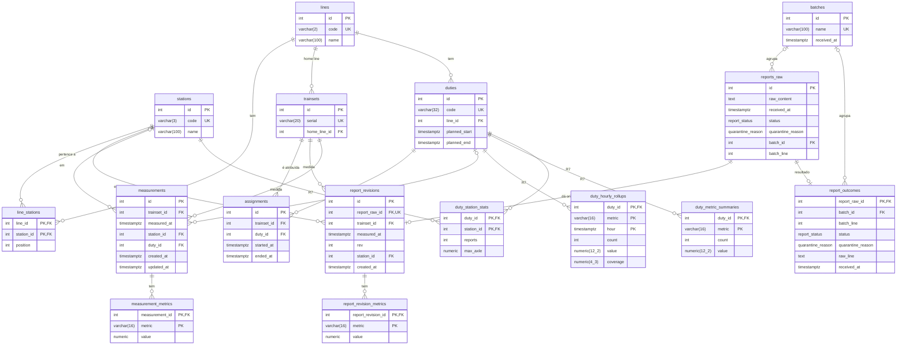

## Tipos enumerados

| Tipo PostgreSQL | Valores | Razão |
|---|---|---|
| `report_status` | `pending`, `applied`, `duplicate`, `quarantined` | Restringe o estado de um relatório a valores conhecidos ao nível da BD. Guarda o valor (`pending`) e não o nome do membro Python (`PENDING`), através de `_enum_values`. |
| `quarantine_reason` | `malformed`, `bad_checksum`, `clock_invalid`, `unknown_trainset`, `unknown_station`, `unknown_metric`, `conflict` | Restringe os motivos de quarentena aos definidos. `conflict` é um motivo e não um estado: um relatório em conflito (R4) fica `quarantined` com `quarantine_reason = conflict`. |

## Extensões

| Extensão | Razão |
|---|---|
| `btree_gist` | Criada na migração inicial. Permite usar o operador `=` sobre colunas `int` num índice GiST, necessário para as exclusion constraints de `assignments` (que combinam `trainset_id =` / `duty_id =` com sobreposição de intervalos `&&`). |

---

## Dados de referência

### `lines`

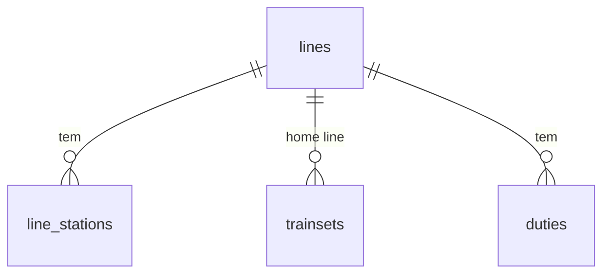

| Constraint / índice | Definição | Razão |
|---|---|---|
| PK | `id` | Chave substituta; as outras tabelas referenciam a linha por `id` e não pelo código. |
| UNIQUE | `code` | O código (ex.: `AZ`) é o identificador de negócio usado no seed, na API e nos relatórios; não pode haver duas linhas com o mesmo código. O índice da UNIQUE serve também a pesquisa por código. |
| NOT NULL | `code`, `name` | Uma linha sem código ou nome não é utilizável. |

### `stations`

| Constraint / índice | Definição | Razão |
|---|---|---|
| PK | `id` | Chave substituta referenciada por `line_stations`, `report_revisions`, `measurements` e `duty_station_stats`. |
| UNIQUE | `code` | O código (ex.: `SSE`) é o que aparece nos relatórios; tem de identificar uma única estação. Uma estação de correspondência existe uma só vez e liga-se a várias linhas por `line_stations`. O índice serve a resolução do código durante o processamento. |
| NOT NULL | `code`, `name` | Uma estação sem código ou nome não é utilizável. |

### `line_stations`

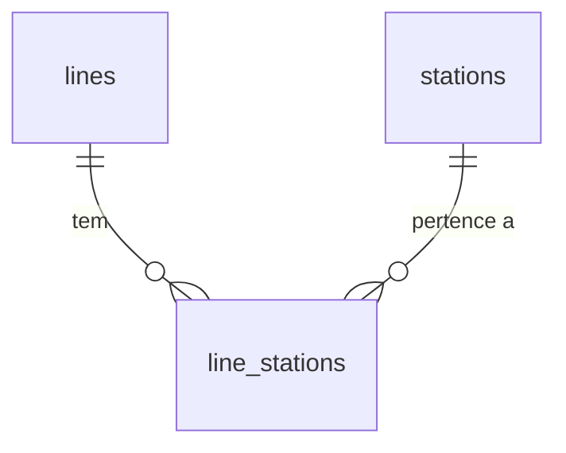

Tabela de associação N:M entre linhas e estações, com a posição de cada estação no percurso.

| Constraint / índice | Definição | Razão |
|---|---|---|
| PK | `(line_id, station_id)` | Uma estação aparece no máximo uma vez em cada linha. Serve também a pesquisa das estações de uma linha (começa por `line_id`). |
| FK | `line_id → lines.id` `ON DELETE CASCADE` | As posições só existem enquanto a linha existe; apagar a linha apaga o seu percurso. |
| FK | `station_id → stations.id` `ON DELETE RESTRICT` | Não se apaga uma estação que ainda faz parte de um percurso. |
| UNIQUE `uq_line_stations_line_position` | `(line_id, position)` | Duas estações não podem ocupar a mesma posição na mesma linha. |
| CHECK `ck_line_stations_position_positive` | `position >= 1` | As posições começam em 1 (primeira estação). |
| Índice `ix_line_stations_station_id` | `station_id` | A PK começa por `line_id` e não serve pesquisas só por `station_id` (ex.: linhas que passam numa estação, e a verificação da FK `RESTRICT` ao apagar uma estação). |

### `trainsets`

| Constraint / índice | Definição | Razão |
|---|---|---|
| PK | `id` | Chave substituta referenciada por `assignments`, `report_revisions` e `measurements`. |
| UNIQUE | `serial` | O serial (ex.: `TS-0001`) é o identificador que vem nos relatórios; tem de identificar uma única composição. O índice serve a resolução do serial durante o processamento. |
| FK | `home_line_id → lines.id` `ON DELETE RESTRICT`, NOT NULL | Toda a composição pertence a uma linha (usada para validar atribuições: a composição tem de ser da linha da duty). Não se apaga uma linha com composições. |
| Índice `ix_trainsets_home_line_id` | `home_line_id` | Pesquisa das composições de uma linha e verificação da FK `RESTRICT` ao apagar uma linha. |

### `duties`

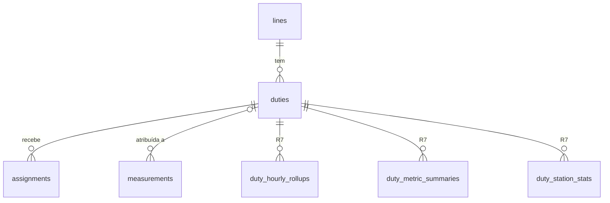

| Constraint / índice | Definição | Razão |
|---|---|---|
| PK | `id` | Chave substituta referenciada por `assignments`, `measurements` e pelas tabelas de rollup. |
| UNIQUE | `code` | O código (ex.: `AZ-D01-20261102`) é o identificador usado na API (`/duties/{code}/...`). O índice serve essa pesquisa. |
| FK | `line_id → lines.id` `ON DELETE RESTRICT`, NOT NULL | Toda a duty é um serviço de uma linha. Não se apaga uma linha com duties. |
| CHECK `ck_duties_planned_interval` | `planned_end > planned_start` | Um serviço planeado tem de ter duração positiva. |
| Índice `ix_duties_line_id` | `line_id` | Pesquisa das duties de uma linha e verificação da FK `RESTRICT`. |

### `assignments`

Liga uma composição a uma duty durante o intervalo `[started_at, ended_at)`.

| Constraint / índice | Definição | Razão |
|---|---|---|
| PK | `id` | Permite referenciar uma atribuição concreta (`PATCH /assignments/{id}`). |
| FK | `trainset_id → trainsets.id` `ON DELETE RESTRICT`, NOT NULL | A atribuição é histórico usado na atribuição de medições (R5); não se apaga uma composição que tenha atribuições. |
| FK | `duty_id → duties.id` `ON DELETE RESTRICT`, NOT NULL | Pelo mesmo motivo, não se apaga uma duty com atribuições. |
| NOT NULL | `started_at`, `ended_at` | O intervalo tem de ser fechado para as exclusion constraints e para a atribuição das medições funcionarem. |
| CHECK `ck_assignments_interval` | `ended_at > started_at` | Um intervalo vazio ou invertido não faz sentido e quebraria o `tstzrange`. |
| EXCLUDE `ex_assignments_trainset_no_overlap` | `USING gist (trainset_id WITH =, tstzrange(started_at, ended_at, '[)') WITH &&)` | Uma composição não pode estar em duas duties ao mesmo tempo. Garantido pela BD mesmo com escritas concorrentes, onde uma verificação na aplicação não chega. O intervalo é semiaberto `[)`, por isso uma atribuição pode começar no instante exato em que a anterior termina. O índice GiST criado pela constraint serve também a pesquisa "que duty tinha esta composição no instante T" (R5). |
| EXCLUDE `ex_assignments_duty_no_overlap` | `USING gist (duty_id WITH =, tstzrange(started_at, ended_at, '[)') WITH &&)` | Uma duty não pode ter duas composições ao mesmo tempo. Mesma justificação. O índice GiST serve também as pesquisas por duty, por isso `duty_id` não tem índice B-tree próprio. |

---

## Ingestão

### `batches`

| Constraint / índice | Definição | Razão |
|---|---|---|
| PK | `id` | Chave substituta usada na API (`/depot/batches/{id}`). |
| UNIQUE | `name` | O nome do ficheiro (ex.: `depot-batch-01`) identifica o batch nas estatísticas; o mesmo ficheiro não é registado duas vezes. |
| NOT NULL + DEFAULT `now()` | `received_at` | A hora de receção é sempre preenchida pela BD, sem depender do cliente. |

### `reports_raw`

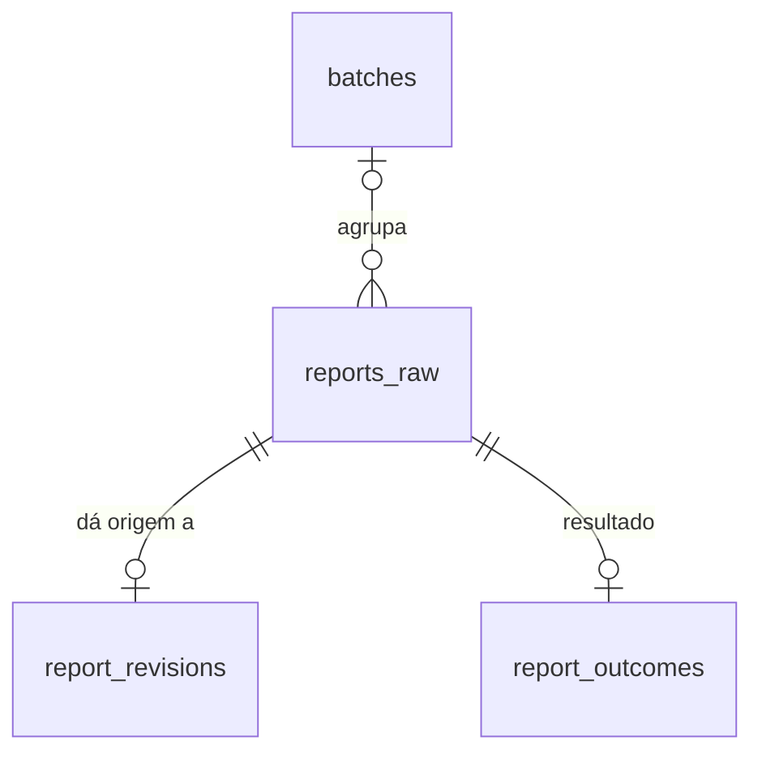

Relatório tal como foi recebido, append-only. `raw_content` nunca é alterado; o Worker só altera `status` e `quarantine_reason`.

| Constraint / índice | Definição | Razão |
|---|---|---|
| PK | `id` | Também define a ordem de chegada: o Worker processa por `id` crescente (R1). |
| NOT NULL | `raw_content` | O relatório original tem de ficar sempre guardado, mesmo que seja inválido, para poder ser reprocessado (R8, A4). |
| NOT NULL + DEFAULT `now()` | `received_at` | Hora de receção preenchida pela BD. |
| NOT NULL + DEFAULT `'pending'` | `status` | Um relatório acabado de gravar pela API está sempre por processar. |
| FK `fk_reports_raw_batch_id_batches` | `batch_id → batches.id` `ON DELETE RESTRICT`, NULL permitido | NULL = relatório enviado em tempo real (`POST /reports`). `RESTRICT` porque a tabela é append-only: não se apaga um batch que tenha relatórios. |
| CHECK `ck_reports_raw_quarantine_reason` | `(status = 'quarantined') = (quarantine_reason IS NOT NULL)` | Há motivo se e só se o relatório está em quarentena. Impede um relatório em quarentena sem motivo e um relatório aplicado com motivo. |
| CHECK `ck_reports_raw_batch_line` | `(batch_id IS NULL) = (batch_line IS NULL)` | `batch_line` só existe, e é obrigatório, quando o relatório veio de um batch. |
| CHECK `ck_reports_raw_batch_line_positive` | `batch_line >= 1` | As linhas do ficheiro são numeradas a partir de 1. |
| UNIQUE `uq_reports_raw_batch_line` | `(batch_id, batch_line)` | A mesma linha do ficheiro não é gravada duas vezes no mesmo batch. Como os relatórios em tempo real têm ambos NULL e o PostgreSQL trata NULL como distinto, não são afetados. O índice serve também a listagem dos relatórios de um batch por ordem de linha (começa por `batch_id`), por isso `batch_id` não tem índice próprio. |
| Índice `ix_reports_raw_status` | `status` | O Worker procura o próximo relatório com `status = 'pending'` (`SELECT ... FOR UPDATE SKIP LOCKED`). Sem índice seria uma leitura completa da tabela, que só cresce. |

---

## Telemetria

### `report_revisions`

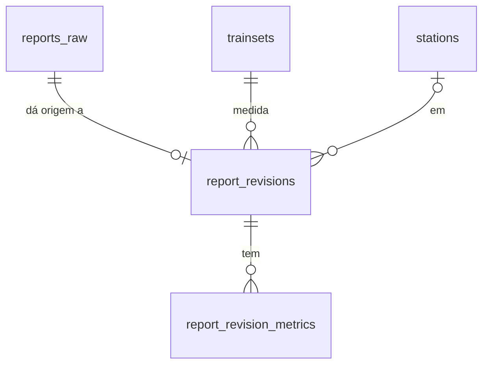

Relatório válido já interpretado: uma revisão (`rev`) da medição identificada por `(trainset_id, measured_at)`.

| Constraint / índice | Definição | Razão |
|---|---|---|
| PK | `id` | Chave substituta referenciada por `report_revision_metrics`. |
| FK + UNIQUE | `report_raw_id → reports_raw.id` `ON DELETE RESTRICT`, NOT NULL | Cada relatório original dá no máximo uma revisão (relação 1:0..1). `RESTRICT` preserva a rastreabilidade até ao relatório original. O índice da UNIQUE serve a navegação `reports_raw → report_revisions`. |
| FK | `trainset_id → trainsets.id` `ON DELETE RESTRICT`, NOT NULL | A revisão refere-se sempre a uma composição conhecida. |
| FK | `station_id → stations.id` `ON DELETE RESTRICT`, NULL permitido | NULL = relatório sem estação (`-`). |
| NOT NULL | `measured_at`, `rev` | Fazem parte da identidade da revisão. |
| CHECK `ck_report_revisions_rev_non_negative` | `rev >= 0` | A primeira revisão é 0. |
| Sem UNIQUE | `(trainset_id, measured_at, rev)` | Intencional: a R4 admite vários relatórios com a mesma identidade quando há conflito, e os candidatos têm de ficar guardados para o conflito ser detetado. |
| Índice `ix_report_revisions_identity` | `(trainset_id, measured_at, rev)` | Procura de todas as revisões de uma medição, por ordem de `rev`, ao aplicar uma revisão nova (R2–R4) e ao reconstruir (A4). |
| Índice `ix_report_revisions_station_id` | `station_id` | Verificação da FK `RESTRICT` ao apagar uma estação e pesquisas por estação. |

### `report_revision_metrics`

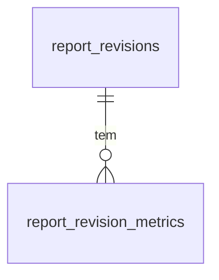

Valores das métricas recebidos numa revisão, uma linha por métrica. Uma métrica nova não obriga a alterar a tabela.

| Constraint / índice | Definição | Razão |
|---|---|---|
| PK | `(report_revision_id, metric)` | Cada métrica aparece no máximo uma vez por revisão. Serve também a leitura das métricas de uma revisão. |
| FK | `report_revision_id → report_revisions.id` `ON DELETE CASCADE` | As métricas não existem sem a revisão. |
| `value` NULL permitido | `numeric` sem precisão | NULL representa a remoção de uma métrica (R3). `numeric` sem precisão fixa guarda o valor exatamente como foi recebido. |

### `measurements`

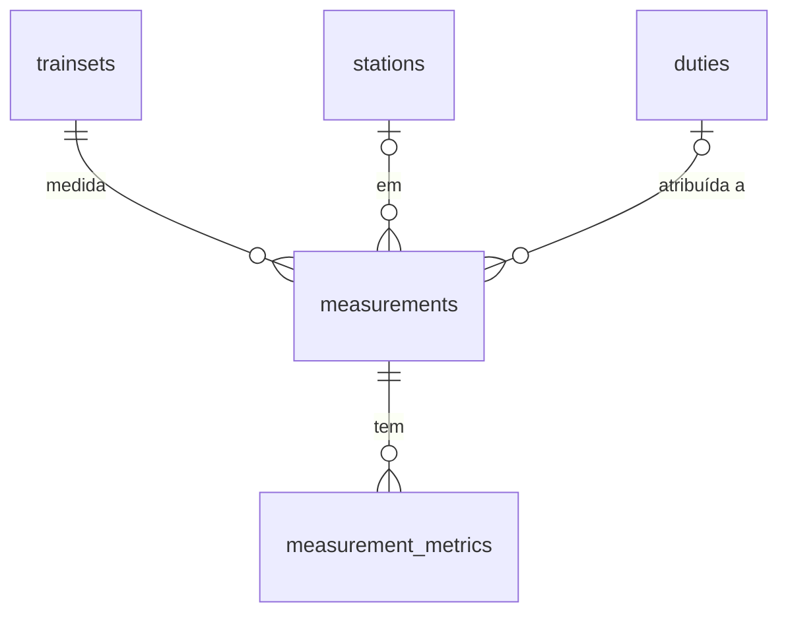

Estado efetivo de uma medição depois de aplicadas as revisões válidas.

| Constraint / índice | Definição | Razão |
|---|---|---|
| PK | `id` | Chave substituta referenciada por `measurement_metrics`. |
| FK | `trainset_id → trainsets.id` `ON DELETE RESTRICT`, NOT NULL | A medição pertence sempre a uma composição conhecida. |
| FK | `station_id → stations.id` `ON DELETE RESTRICT`, NULL permitido | NULL = medição sem estação (`-`). |
| FK | `duty_id → duties.id` `ON DELETE RESTRICT`, NULL permitido | NULL = medição não atribuída a nenhuma duty (R5). `RESTRICT` porque apagar a duty deixaria a atribuição inconsistente. |
| NOT NULL + DEFAULT `now()` | `created_at`, `updated_at` | Auditoria preenchida pela BD; `updated_at` é atualizado em cada alteração. |
| UNIQUE `uq_measurements_trainset_measured_at` | `(trainset_id, measured_at)` | Existe uma só medição efetiva por composição e instante; as revisões são aplicadas sobre ela. O índice serve também a procura da medição ao aplicar uma revisão, e a verificação da FK de `trainset_id`. |
| Índice `ix_measurements_duty_measured_at` | `(duty_id, measured_at)` | `GET /duties/{code}/readings` e os rollups R7 leem as medições de uma duty por ordem temporal. Serve também a verificação da FK de `duty_id`. |
| Índice `ix_measurements_station_id` | `station_id` | Verificação da FK `RESTRICT` ao apagar uma estação e pesquisas por estação. |

### `measurement_metrics`

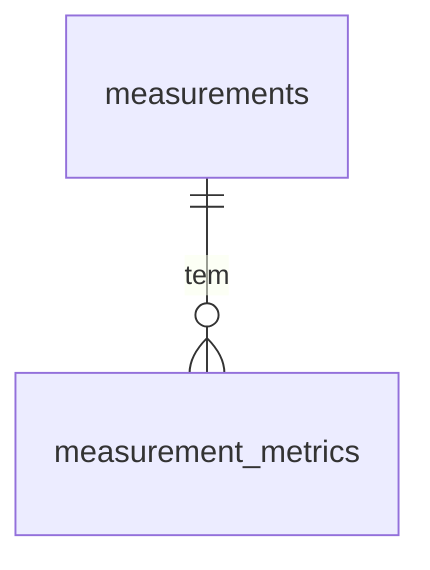

Valores efetivos das métricas de uma medição.

| Constraint / índice | Definição | Razão |
|---|---|---|
| PK | `(measurement_id, metric)` | Cada métrica aparece no máximo uma vez por medição. Serve a leitura das métricas de uma medição. |
| FK | `measurement_id → measurements.id` `ON DELETE CASCADE` | Os valores não existem sem a medição. |
| `value` NULL permitido | `numeric` sem precisão | Guarda o valor exatamente como foi recebido; as leituras filtram `value IS NOT NULL`. |
| Índice `ix_measurement_metrics_metric` | `(metric, measurement_id)` | Consultas por métrica (ex.: `readings?metric=`). A PK começa por `measurement_id` e não serve filtros só por `metric`. |

---

## Read models (A2)

Escritos pelo Worker na mesma transação em que processa cada relatório. Os endpoints de leitura leem estas tabelas em vez de recalcular a partir de `reports_raw` / `measurements`.

### `report_outcomes`

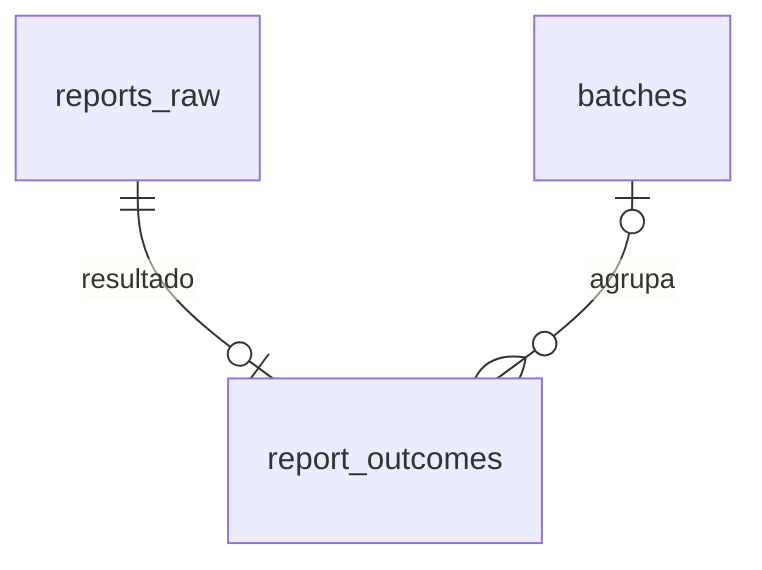

Resultado de cada relatório já processado. Um relatório sem linha aqui ainda está por processar.

| Constraint / índice | Definição | Razão |
|---|---|---|
| PK + FK | `report_raw_id → reports_raw.id` `ON DELETE CASCADE` | Uma linha por relatório (1:0..1). É uma tabela derivada: se o relatório desaparecer, o resultado deixa de fazer sentido. |
| FK | `batch_id → batches.id` `ON DELETE CASCADE`, NULL permitido | Cópia da origem para evitar o join com `reports_raw`. `CASCADE` porque é derivada. |
| NOT NULL | `status`, `raw_line`, `received_at` | Os endpoints mostram sempre estes campos. |
| CHECK `ck_report_outcomes_processed` | `status <> 'pending'` | Só relatórios processados têm resultado. |
| CHECK `ck_report_outcomes_quarantine_reason` | `(status = 'quarantined') = (quarantine_reason IS NOT NULL)` | A mesma regra de `reports_raw`: há motivo se e só se está em quarentena. |
| Índice `ix_report_outcomes_batch_id` | `batch_id` | `GET /depot/batches/{id}` conta os resultados de um batch. |
| Índice `ix_report_outcomes_reason_received_at` | `(quarantine_reason, received_at)` | `GET /quarantine?reason=` filtra por motivo e ordena pelos mais recentes. Serve também a contagem por motivo em `/stats`. |

### `duty_hourly_rollups`

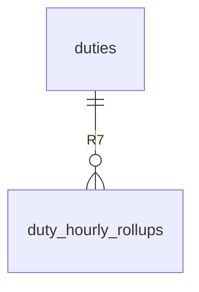

R7: por duty, métrica e hora UTC.

| Constraint / índice | Definição | Razão |
|---|---|---|
| PK | `(duty_id, metric, hour)` | Uma linha por duty, métrica e hora. Serve a leitura da série horária de uma métrica numa duty, ordenada por `hour`. |
| FK | `duty_id → duties.id` `ON DELETE CASCADE` | Tabela derivada: sem duty não há rollup. |
| NOT NULL | `count`, `value`, `coverage` | Uma hora só tem linha quando há leituras. |
| CHECK `ck_duty_hourly_rollups_count_positive` | `count > 0` | Uma hora sem leituras não tem linha; nunca se guarda uma contagem a zero. |
| Tipos | `value numeric(12,2)`, `coverage numeric(4,3)` | Precisão fixa igual à exposta pela API. |

### `duty_metric_summaries`

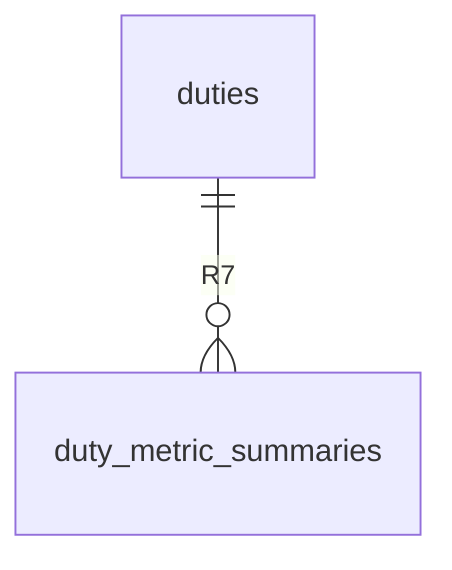

R7: por duty e métrica, o valor sobre a duty inteira.

| Constraint / índice | Definição | Razão |
|---|---|---|
| PK | `(duty_id, metric)` | Uma linha por duty e métrica. Serve a leitura do resumo de uma duty. |
| FK | `duty_id → duties.id` `ON DELETE CASCADE` | Tabela derivada. |
| NOT NULL | `count`, `value` | Só existe linha quando há leituras. |
| CHECK `ck_duty_metric_summaries_count_positive` | `count > 0` | Sem leituras não há linha. |

### `duty_station_stats`

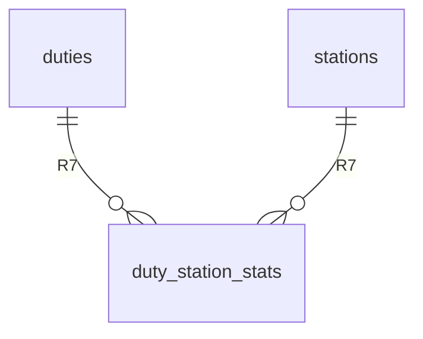

R7: por duty e estação, o número de relatórios e o maior valor `AX*`.

| Constraint / índice | Definição | Razão |
|---|---|---|
| PK | `(duty_id, station_id)` | Uma linha por duty e estação. Serve a leitura das estatísticas de uma duty. |
| FK | `duty_id → duties.id` `ON DELETE CASCADE` | Tabela derivada. |
| FK | `station_id → stations.id` `ON DELETE RESTRICT` | Não se apaga uma estação que aparece nas estatísticas. |
| NOT NULL | `reports` | Só existe linha quando há relatórios. |
| CHECK `ck_duty_station_stats_reports_positive` | `reports > 0` | Sem relatórios não há linha. |
| `max_axle` NULL permitido | `numeric` | NULL = nenhuma métrica `AX*` nas medições dessa estação. |
