## ER diagram (overview)

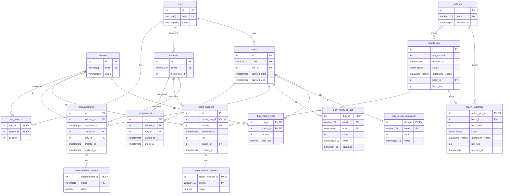

## Enum types

| PostgreSQL type | Values | Reason |
|---|---|---|
| `report_status` | `pending`, `applied`, `duplicate`, `quarantined` | Restricts a report's status to values known at the DB level. Stores the value (`pending`), not the Python member name (`PENDING`), via `_enum_values`. |
| `quarantine_reason` | `malformed`, `bad_checksum`, `clock_invalid`, `unknown_trainset`, `unknown_station`, `unknown_metric`, `conflict` | Restricts quarantine reasons to those defined. `conflict` is a reason and not a status: a report in conflict (R4) is `quarantined` with `quarantine_reason = conflict`. |

## Extensions

| Extension | Reason |
|---|---|
| `btree_gist` | Created in the initial migration. Allows using the `=` operator on `int` columns in a GiST index, required for the exclusion constraints on `assignments` (which combine `trainset_id =` / `duty_id =` with range overlap `&&`). |

---

## Reference data

### `lines`

| Constraint / index | Definition | Reason |
|---|---|---|
| PK | `id` | Surrogate key; other tables reference the line by `id`, not by code. |
| UNIQUE | `code` | The code (e.g. `AZ`) is the business identifier used in the seed, the API and reports; there cannot be two lines with the same code. The UNIQUE index also serves lookups by code. |
| NOT NULL | `code`, `name` | A line without a code or name is not usable. |

### `stations`

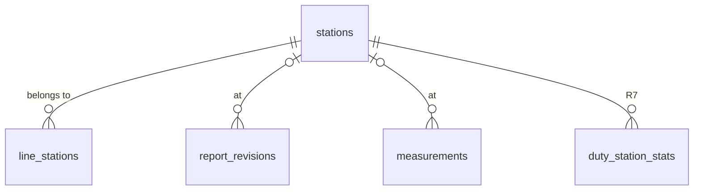

| Constraint / index | Definition | Reason |
|---|---|---|
| PK | `id` | Surrogate key referenced by `line_stations`, `report_revisions`, `measurements` and `duty_station_stats`. |
| UNIQUE | `code` | The code (e.g. `SSE`) is what appears in reports; it must identify a single station. An interchange station exists only once and connects to several lines via `line_stations`. The index is used for code resolution during processing. |
| NOT NULL | `code`, `name` | A station without a code or name is not usable. |

### `line_stations`

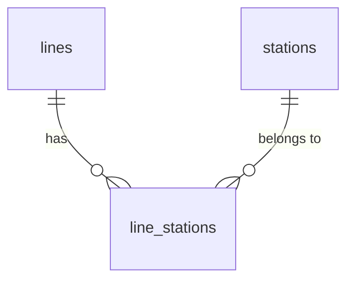

N:M association table between lines and stations, with the position of each station on the route.

| Constraint / index | Definition | Reason |
|---|---|---|
| PK | `(line_id, station_id)` | A station appears at most once in each line. It also serves lookups of a line's stations (starts with `line_id`). |
| FK | `line_id → lines.id` `ON DELETE CASCADE` | Positions only exist while the line exists; deleting the line deletes its route. |
| FK | `station_id → stations.id` `ON DELETE RESTRICT` | Do not delete a station that is still part of a route. |
| UNIQUE `uq_line_stations_line_position` | `(line_id, position)` | Two stations cannot occupy the same position in the same line. |
| CHECK `ck_line_stations_position_positive` | `position >= 1` | Positions start at 1 (first station). |
| Index `ix_line_stations_station_id` | `station_id` | The PK starts with `line_id` and does not serve lookups by `station_id` alone (e.g. lines passing through a station, and the `RESTRICT` FK check when deleting a station). |

### `trainsets`

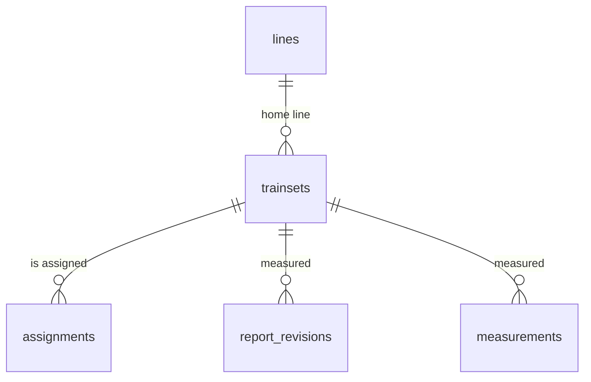

| Constraint / index | Definition | Reason |
|---|---|---|
| PK | `id` | Surrogate key referenced by `assignments`, `report_revisions` and `measurements`. |
| UNIQUE | `serial` | The serial (e.g. `TS-0001`) is the identifier that comes in reports; it must identify a single trainset. The index is used for serial resolution during processing. |
| FK | `home_line_id → lines.id` `ON DELETE RESTRICT`, NOT NULL | Every trainset belongs to a line (used to validate assignments: the trainset must be from the duty's line). Do not delete a line with trainsets. |
| Index `ix_trainsets_home_line_id` | `home_line_id` | Lookups of a line's trainsets and the `RESTRICT` FK check when deleting a line. |

### `duties`

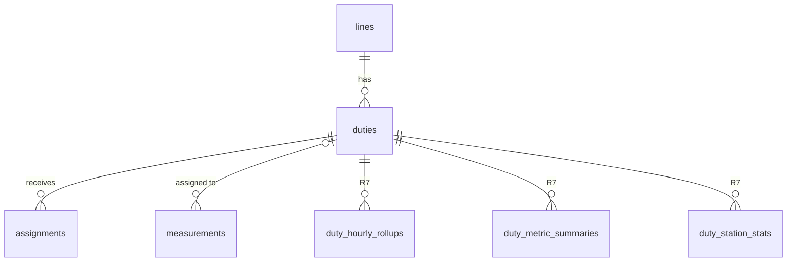

| Constraint / index | Definition | Reason |
|---|---|---|
| PK | `id` | Surrogate key referenced by `assignments`, `measurements` and the rollup tables. |
| UNIQUE | `code` | The code (e.g. `AZ-D01-20261102`) is the identifier used in the API (`/duties/{code}/...`). The index serves that lookup. |
| FK | `line_id → lines.id` `ON DELETE RESTRICT`, NOT NULL | Every duty is a service of a line. Do not delete a line with duties. |
| CHECK `ck_duties_planned_interval` | `planned_end > planned_start` | A planned service must have a positive duration. |
| Index `ix_duties_line_id` | `line_id` | Lookups of a line's duties and the `RESTRICT` FK check. |

### `assignments`

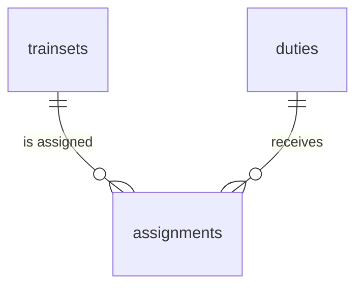

Links a trainset to a duty during the range `[started_at, ended_at)`.

| Constraint / index | Definition | Reason |
|---|---|---|
| PK | `id` | Allows referencing a specific assignment (`PATCH /assignments/{id}`). |
| FK | `trainset_id → trainsets.id` `ON DELETE RESTRICT`, NOT NULL | The assignment is history used in measurement attribution (R5); do not delete a trainset that has assignments. |
| FK | `duty_id → duties.id` `ON DELETE RESTRICT`, NOT NULL | For the same reason, do not delete a duty with assignments. |
| NOT NULL | `started_at`, `ended_at` | The range must be closed for the exclusion constraints and for measurement attribution to work. |
| CHECK `ck_assignments_interval` | `ended_at > started_at` | An empty or inverted range makes no sense and would break `tstzrange`. |
| EXCLUDE `ex_assignments_trainset_no_overlap` | `USING gist (trainset_id WITH =, tstzrange(started_at, ended_at, '[)') WITH &&)` | A trainset cannot be in two duties at the same time. Guaranteed by the DB even with concurrent writes, where an application-level check is not enough. The range is half-open `[)`, so an assignment can start at the exact instant the previous one ends. The GiST index created by the constraint also serves the lookup "which duty had this trainset at instant T" (R5). |
| EXCLUDE `ex_assignments_duty_no_overlap` | `USING gist (duty_id WITH =, tstzrange(started_at, ended_at, '[)') WITH &&)` | A duty cannot have two trainsets at the same time. Same rationale. The GiST index also serves lookups by duty, so `duty_id` has no separate B-tree index. |

---

## Ingestion

### `batches`

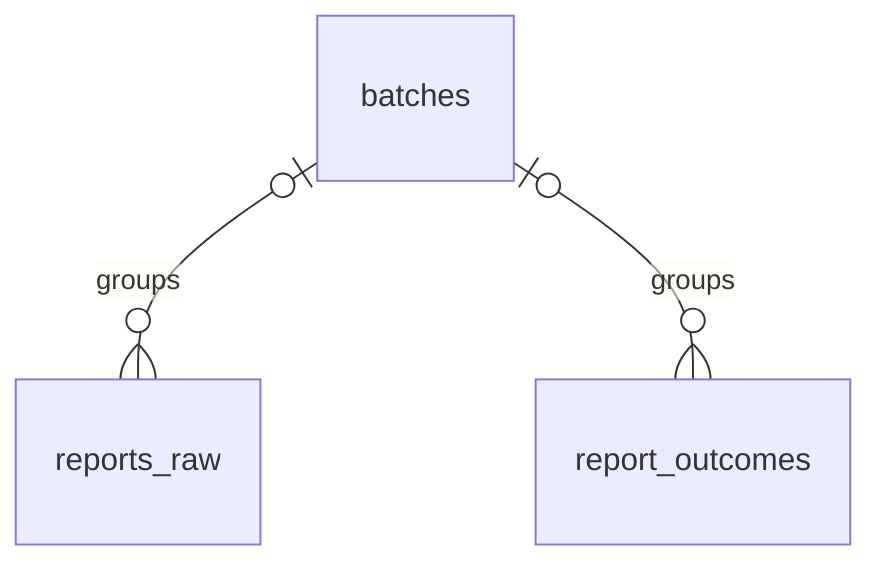

| Constraint / index | Definition | Reason |
|---|---|---|
| PK | `id` | Surrogate key used in the API (`/depot/batches/{id}`). |
| UNIQUE | `name` | The file name (e.g. `depot-batch-01`) identifies the batch in statistics; the same file is not registered twice. |
| NOT NULL + DEFAULT `now()` | `received_at` | The arrival time is always filled in by the DB, without depending on the client. |

### `reports_raw`

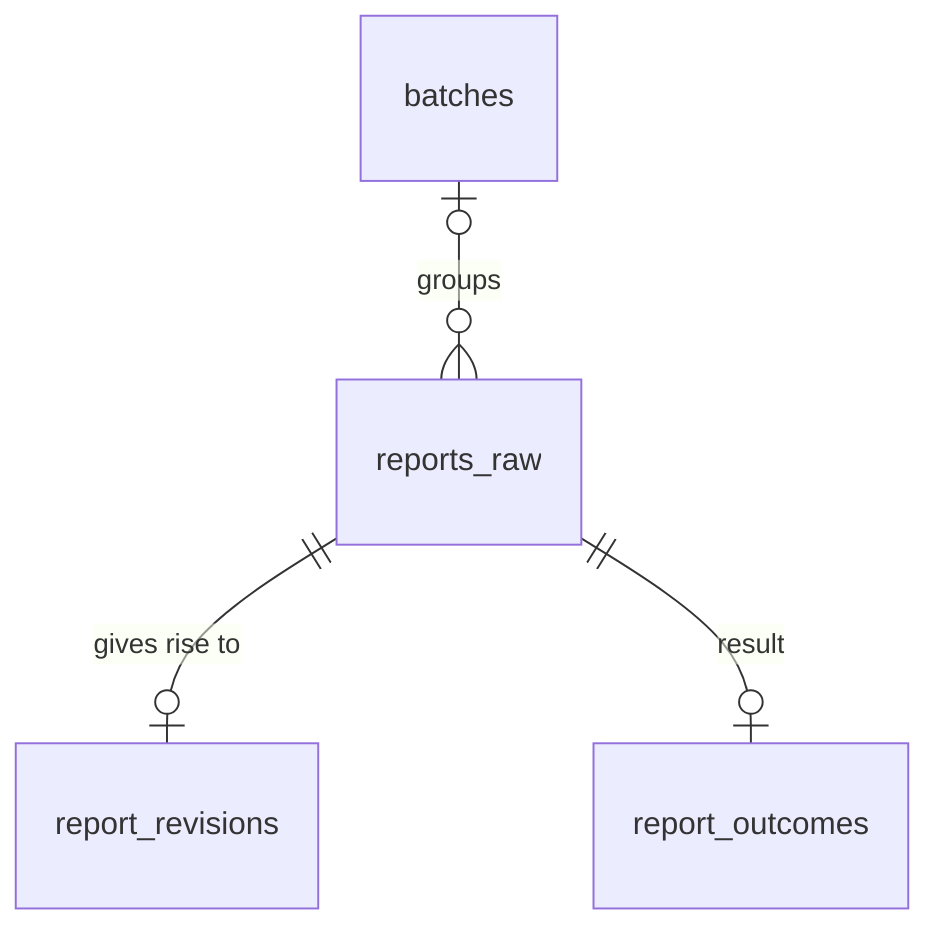

Report as received, append-only. `raw_content` is never changed; the Worker only changes `status` and `quarantine_reason`.

| Constraint / index | Definition | Reason |
|---|---|---|
| PK | `id` | It also defines the arrival order: the Worker processes by increasing `id` (R1). |
| NOT NULL | `raw_content` | The original report must always be stored, even if invalid, so that it can be reprocessed (R8, A4). |
| NOT NULL + DEFAULT `now()` | `received_at` | Arrival time filled in by the DB. |
| NOT NULL + DEFAULT `'pending'` | `status` | A report just stored by the API is always pending processing. |
| FK `fk_reports_raw_batch_id_batches` | `batch_id → batches.id` `ON DELETE RESTRICT`, NULL allowed | NULL = report sent in real time (`POST /reports`). `RESTRICT` because the table is append-only: do not delete a batch that has reports. |
| CHECK `ck_reports_raw_quarantine_reason` | `(status = 'quarantined') = (quarantine_reason IS NOT NULL)` | There is a reason if and only if the report is in quarantine. Prevents a quarantined report without a reason and an applied report with a reason. |
| CHECK `ck_reports_raw_batch_line` | `(batch_id IS NULL) = (batch_line IS NULL)` | `batch_line` only exists, and is mandatory, when the report came from a batch. |
| CHECK `ck_reports_raw_batch_line_positive` | `batch_line >= 1` | File lines are numbered starting at 1. |
| UNIQUE `uq_reports_raw_batch_line` | `(batch_id, batch_line)` | The same file line is not stored twice in the same batch. Since real-time reports have both NULL and PostgreSQL treats NULL as distinct, they are unaffected. The index also serves listing a batch's reports in line order (starts with `batch_id`), so `batch_id` has no separate index. |
| Index `ix_reports_raw_status` | `status` | The Worker looks for the next report with `status = 'pending'` (`SELECT ... FOR UPDATE SKIP LOCKED`). Without an index it would be a full table scan on a table that only grows. |

---

## Telemetry

### `report_revisions`

Valid report already interpreted: a revision (`rev`) of the measurement identified by `(trainset_id, measured_at)`.

| Constraint / index | Definition | Reason |
|---|---|---|
| PK | `id` | Surrogate key referenced by `report_revision_metrics`. |
| FK + UNIQUE | `report_raw_id → reports_raw.id` `ON DELETE RESTRICT`, NOT NULL | Each original report produces at most one revision (1:0..1 relationship). `RESTRICT` preserves traceability back to the original report. The UNIQUE index serves navigation `reports_raw → report_revisions`. |
| FK | `trainset_id → trainsets.id` `ON DELETE RESTRICT`, NOT NULL | A revision always refers to a known trainset. |
| FK | `station_id → stations.id` `ON DELETE RESTRICT`, NULL allowed | NULL = report without a station (`-`). |
| NOT NULL | `measured_at`, `rev` | They are part of the revision's identity. |
| CHECK `ck_report_revisions_rev_non_negative` | `rev >= 0` | The first revision is 0. |
| No UNIQUE | `(trainset_id, measured_at, rev)` | Intentional: R4 allows several reports with the same identity when there is a conflict, and the candidates must be stored for the conflict to be detected. |
| Index `ix_report_revisions_identity` | `(trainset_id, measured_at, rev)` | Lookup of all revisions of a measurement, in `rev` order, when applying a new revision (R2–R4) and when rebuilding (A4). |
| Index `ix_report_revisions_station_id` | `station_id` | `RESTRICT` FK check when deleting a station and lookups by station. |

### `report_revision_metrics`

Metric values received in a revision, one row per metric. A new metric does not require changing the table.

| Constraint / index | Definition | Reason |
|---|---|---|
| PK | `(report_revision_id, metric)` | Each metric appears at most once per revision. It also serves reading a revision's metrics. |
| FK | `report_revision_id → report_revisions.id` `ON DELETE CASCADE` | Metrics do not exist without the revision. |
| `value` NULL allowed | `numeric` without precision | NULL represents the removal of a metric (R3). `numeric` without fixed precision stores the value exactly as it was received. |

### `measurements`

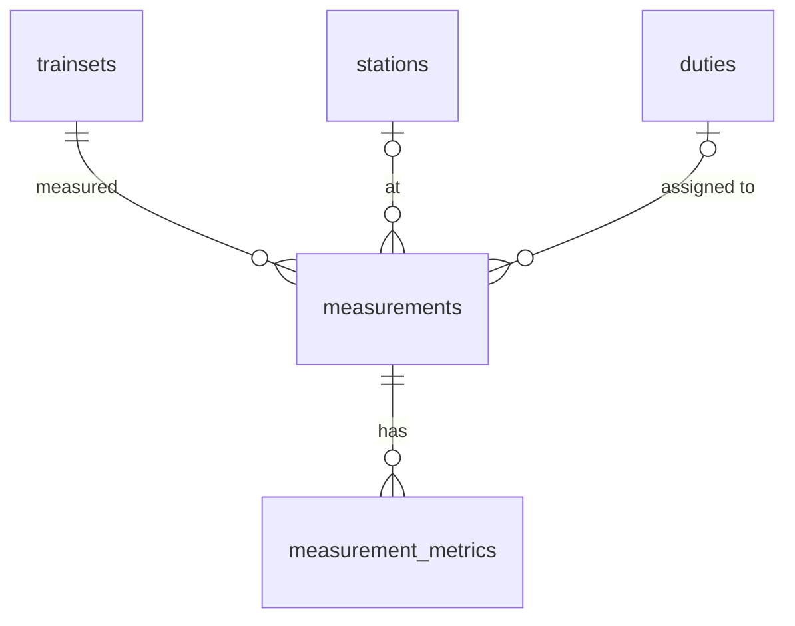

Effective state of a measurement after valid revisions have been applied.

| Constraint / index | Definition | Reason |
|---|---|---|
| PK | `id` | Surrogate key referenced by `measurement_metrics`. |
| FK | `trainset_id → trainsets.id` `ON DELETE RESTRICT`, NOT NULL | A measurement always belongs to a known trainset. |
| FK | `station_id → stations.id` `ON DELETE RESTRICT`, NULL allowed | NULL = measurement without a station (`-`). |
| FK | `duty_id → duties.id` `ON DELETE RESTRICT`, NULL allowed | NULL = measurement not assigned to any duty (R5). `RESTRICT` because deleting the duty would leave the assignment inconsistent. |
| NOT NULL + DEFAULT `now()` | `created_at`, `updated_at` | Audit fields filled in by the DB; `updated_at` is updated on every change. |
| UNIQUE `uq_measurements_trainset_measured_at` | `(trainset_id, measured_at)` | There is only one effective measurement per trainset and instant; revisions are applied on top of it. The index also serves the lookup of the measurement when applying a revision, and the `trainset_id` FK check. |
| Index `ix_measurements_duty_measured_at` | `(duty_id, measured_at)` | `GET /duties/{code}/readings` and R7 rollups read a duty's measurements in temporal order. It also serves the `duty_id` FK check. |
| Index `ix_measurements_station_id` | `station_id` | `RESTRICT` FK check when deleting a station and lookups by station. |

### `measurement_metrics`

Effective metric values of a measurement.

| Constraint / index | Definition | Reason |
|---|---|---|
| PK | `(measurement_id, metric)` | Each metric appears at most once per measurement. It serves reading a measurement's metrics. |
| FK | `measurement_id → measurements.id` `ON DELETE CASCADE` | Values do not exist without the measurement. |
| `value` NULL allowed | `numeric` without precision | Stores the value exactly as it was received; reads filter `value IS NOT NULL`. |
| Index `ix_measurement_metrics_metric` | `(metric, measurement_id)` | Queries by metric (e.g. `readings?metric=`). The PK starts with `measurement_id` and does not serve filters on `metric` alone. |

---

## Read models (A2)

Written by the Worker in the same transaction in which it processes each report. The read endpoints read these tables instead of recalculating from `reports_raw` / `measurements`.

### `report_outcomes`

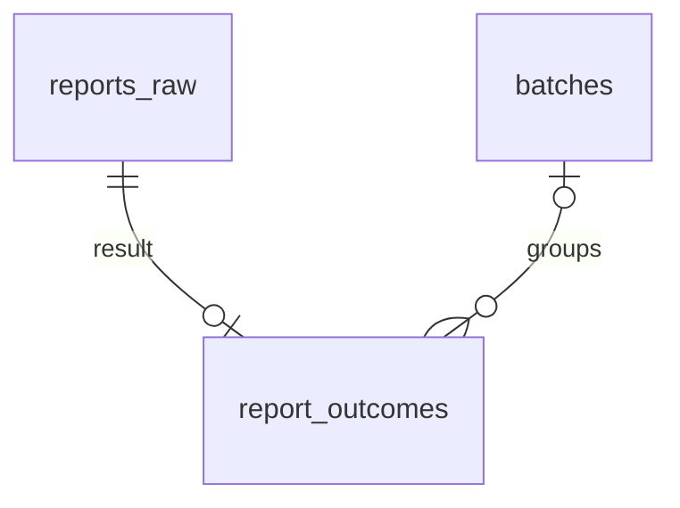

Result of each already processed report. A report with no row here is still pending processing.

| Constraint / index | Definition | Reason |
|---|---|---|
| PK + FK | `report_raw_id → reports_raw.id` `ON DELETE CASCADE` | One row per report (1:0..1). It is a derived table: if the report disappears, the result no longer makes sense. |
| FK | `batch_id → batches.id` `ON DELETE CASCADE`, NULL allowed | Copy of the origin to avoid joining with `reports_raw`. `CASCADE` because it is derived. |
| NOT NULL | `status`, `raw_line`, `received_at` | The endpoints always show these fields. |
| CHECK `ck_report_outcomes_processed` | `status <> 'pending'` | Only processed reports have a result. |
| CHECK `ck_report_outcomes_quarantine_reason` | `(status = 'quarantined') = (quarantine_reason IS NOT NULL)` | The same rule as `reports_raw`: there is a reason if and only if it is in quarantine. |
| Index `ix_report_outcomes_batch_id` | `batch_id` | `GET /depot/batches/{id}` counts the results of a batch. |
| Index `ix_report_outcomes_reason_received_at` | `(quarantine_reason, received_at)` | `GET /quarantine?reason=` filters by reason and orders by most recent. It also serves the count by reason in `/stats`. |

### `duty_hourly_rollups`

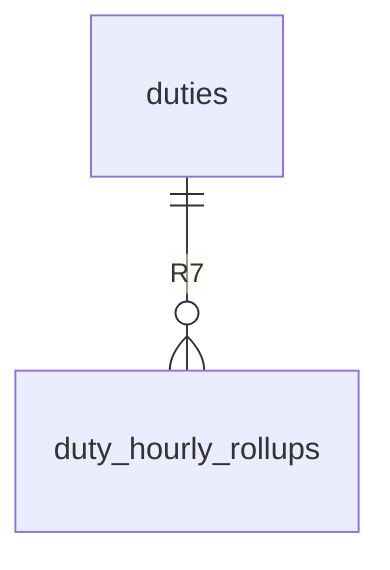

R7: per duty, metric and UTC hour.

| Constraint / index | Definition | Reason |
|---|---|---|
| PK | `(duty_id, metric, hour)` | One row per duty, metric and hour. It serves reading the hourly series of a metric in a duty, ordered by `hour`. |
| FK | `duty_id → duties.id` `ON DELETE CASCADE` | Derived table: without a duty there is no rollup. |
| NOT NULL | `count`, `value`, `coverage` | An hour only has a row when there are readings. |
| CHECK `ck_duty_hourly_rollups_count_positive` | `count > 0` | An hour without readings has no row; a zero count is never stored. |
| Types | `value numeric(12,2)`, `coverage numeric(4,3)` | Fixed precision matching what the API exposes. |

### `duty_metric_summaries`

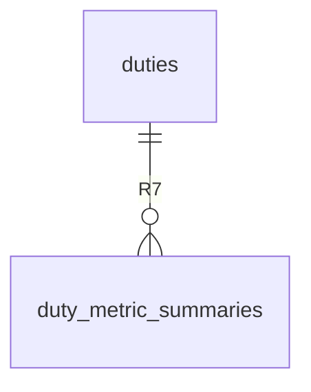

R7: per duty and metric, the value over the whole duty.

| Constraint / index | Definition | Reason |
|---|---|---|
| PK | `(duty_id, metric)` | One row per duty and metric. It serves reading a duty's summary. |
| FK | `duty_id → duties.id` `ON DELETE CASCADE` | Derived table. |
| NOT NULL | `count`, `value` | A row only exists when there are readings. |
| CHECK `ck_duty_metric_summaries_count_positive` | `count > 0` | Without readings there is no row. |

### `duty_station_stats`

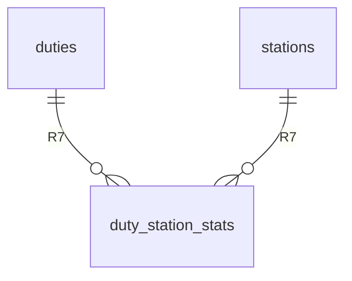

R7: per duty and station, the number of reports and the largest `AX*` value.

| Constraint / index | Definition | Reason |
|---|---|---|
| PK | `(duty_id, station_id)` | One row per duty and station. It serves reading a duty's statistics. |
| FK | `duty_id → duties.id` `ON DELETE CASCADE` | Derived table. |
| FK | `station_id → stations.id` `ON DELETE RESTRICT` | Do not delete a station that appears in the statistics. |
| NOT NULL | `reports` | A row only exists when there are reports. |
| CHECK `ck_duty_station_stats_reports_positive` | `reports > 0` | Without reports there is no row. |
| `max_axle` NULL allowed | `numeric` | NULL = no `AX*` metric in the measurements of that station. |
